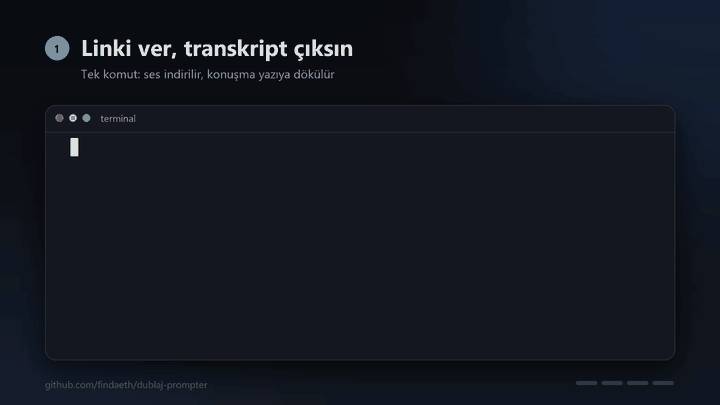
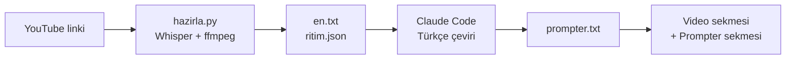

  
  
  
  

## Hızlı başlangıç

1. Depoyu indir: **Code → Download ZIP** (GitHub hesabı gerekmez) ya da `git clone`.
2. Klasörü Claude Code'da aç (`claude`) ve şunu yaz: `Şu videoyu hazırla: <YouTube linki>`
3. Claude'un söylediği komutu PowerShell'de çalıştır: `.\baslat.bat <video-id>`

İki sekme açılır. **Video sekmesini** Meet'e ya da kayda paylaş, **prompter sekmesini** kendine sakla.

## Neler yapar

| | |
|---|---|
| **Linkten transkript** | YouTube linkinden sesi indirir, Whisper ile zaman damgalı İngilizce transkript çıkarır. Videoda altyazı olmasa da çalışır. |
| **Doğal Türkçe metin** | Claude Code, anlam sırasını koruyarak seslendirmeye uygun, nefes yerlerinden bölünmüş Türkçeye çevirir. |
| **Videoyla senkron akış** | Metin videonun saniyesine göre kayar. Videoyu durdurup 5-10 sn ileri geri sarabilir, bir satıra tıklayıp o saniyeye atlayabilirsin. |
| **Karaoke dolumu** | Aktif satırdaki kelimeler konuşmayla birlikte soluk griden beyaza dolar. Dolum konuşmacının gerçek duraklarında bekler, ortak kelimelerde (isim, sayı, terim) İngilizce kelimenin söylendiği anda tutar. |
| **İngilizce ipucu** | Her bloğun başında konuşmacının ilk ve son sözleri küçük, mavi satırda görünür, yerini bulman kolaylaşır. |
| **Yerel ve hesapsız** | Her şey bilgisayarında çalışır, hesap ve sunucu gerekmez. |

## Nasıl çalışır

## Gereksinimler (Windows)
- Python 3.10+
- Node.js (yt-dlp YouTube için JavaScript çalıştırıcısı olarak kullanır)
- ffmpeg: `winget install Gyan.FFmpeg`
- Python paketleri: `pip install faster-whisper yt-dlp pyyaml "av==16.1.0"`

`av` sürümünü 16.1.0'da tut. `faster-whisper` 1.2.1 ile `av` 19 uyumsuz.

## Elle kullanım
1. Transkript çıkar: `python hazirla.py "<youtube linki>"`. Çıktı `veri/<video-id>/en.txt` ve karaoke zamanları için `ritim.json`.
2. Transkripti Türkçeye çevir ve `veri/<video-id>/prompter.txt` olarak kaydet (bu depodaki `CLAUDE.md`, Claude Code ile bunu yapmanı sağlar).
3. PowerShell'de `.\baslat.bat <video-id>` çalıştır. İki sekme açılır: video sekmesi (Meet'e ya da kayda bunu paylaş) ve prompter sekmesi.
4. Prompter sekmesinde: düğmeler ve `Space`, `←`, `→` (Shift ile 10 sn) ile videoyu yönet. Bir satıra tıklayınca video o saniyeye atlar.

Eski video ve prompter sekmelerini yeni video açmadan önce kapat. Sunucu terminalde çalışır, kapatmak için `Ctrl+C`.

<b>prompter.txt biçimi</b>

`ornek/prompter.txt` dosyasına bak. Kısaca:
- `[m:ss]` ya da `[m:ss - NOT]` yeni bloğu başlatır. Metin bloğun saniyesinden bir sonraki bloğa kadar yayılır.
- `.` tek başına satır: boşluk.
- `~ "ilk sözler" ... "son sözler"`: adamın bloğa başlarken ve bitirirken söylediği İngilizce sözler. Küçük, mavi ve okunmaz, yerini bulmak içindir. Üstteki "İng. ipucu" ile gizlenir.

<b>Sürümler</b>

- `v1`: ilk yayın sürümü. Karaoke, konuşma ritmi, sessizlik kırpma ve kelime çapaları.
- `test_surum_1`: ara test sürümü, karaoke dolumu (kelime payı harf uzunluğuna göre).
- `test_surum_2`: ara test sürümü, konuşma ritmine göre dolum.

Eski bir sürüme dönmek için: `git checkout test_surum_2 -- prompter.html hazirla.py`. `v1`'e dönmek için `v1` yaz.

<b>Notlar ve sınırlar</b>

- Yalnızca kendi videon ya da dublaj izni olan videolarla kullan. Üçüncü kişilerin videolarının transkriptini ve çevirisini depoya koyma (`veri/` bu yüzden `.gitignore`'da).
- Whisper Türkçe sesi İngilizceden kötü yazar. Transkripti çıkarmak için İngilizce videolar uygundur.
- Karaoke çapaları yalnızca ortak kelimelerde (özel isim, sayı, teknik terim) çalışır. Diğer kelimelerde dolum konuşma ritmine göre yaklaşıktır. Prompter'ın üst çubuğunda "ritim: v3, çapa N/M" yazar. `ritim.json` yoksa (eski videolar) hece sayısına göre yedek dağılım kullanılır, `hazirla.py`'yi yeniden çalıştır.
- Senkron tarayıcıda YouTube IFrame API'ye dayanır. Reklam çıkarsa zaman kayar. Tarayıcı, video sekmesine hiç tıklanmadan gelen "oynat" komutunu engelleyebilir, bu durumda videoyu bir kez elle başlat.

---

Geliştirici: <a href="https://github.com/findaeth"><b>findaeth</b></a>

